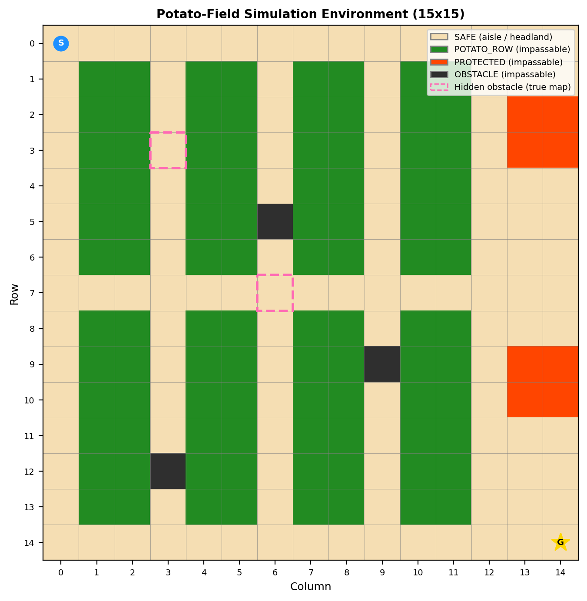
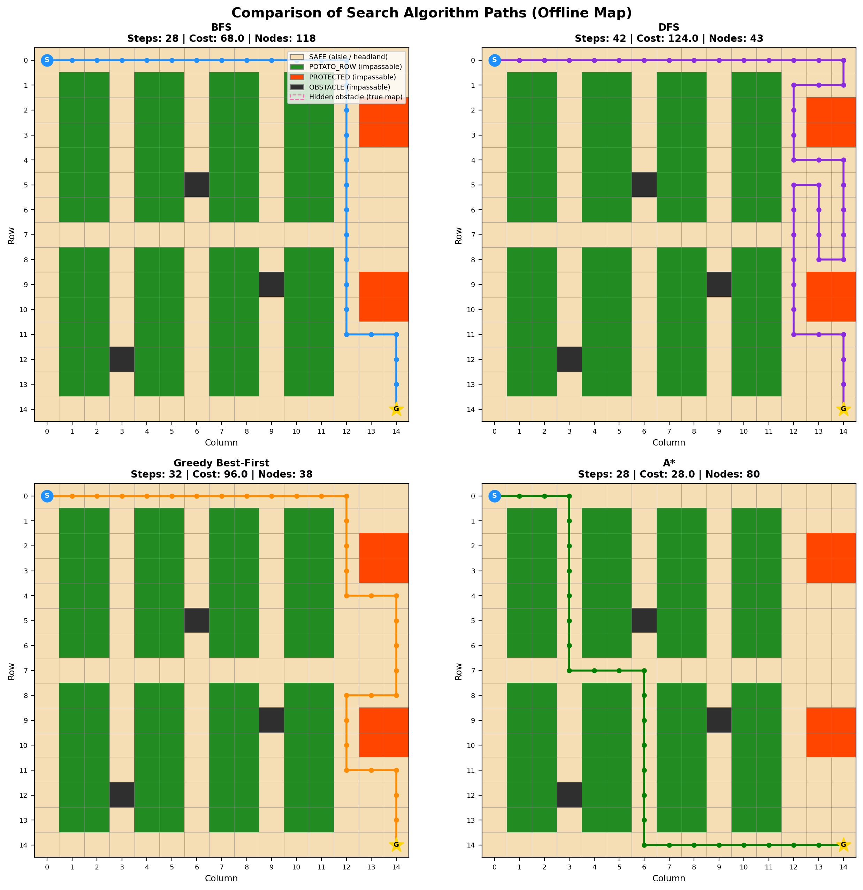
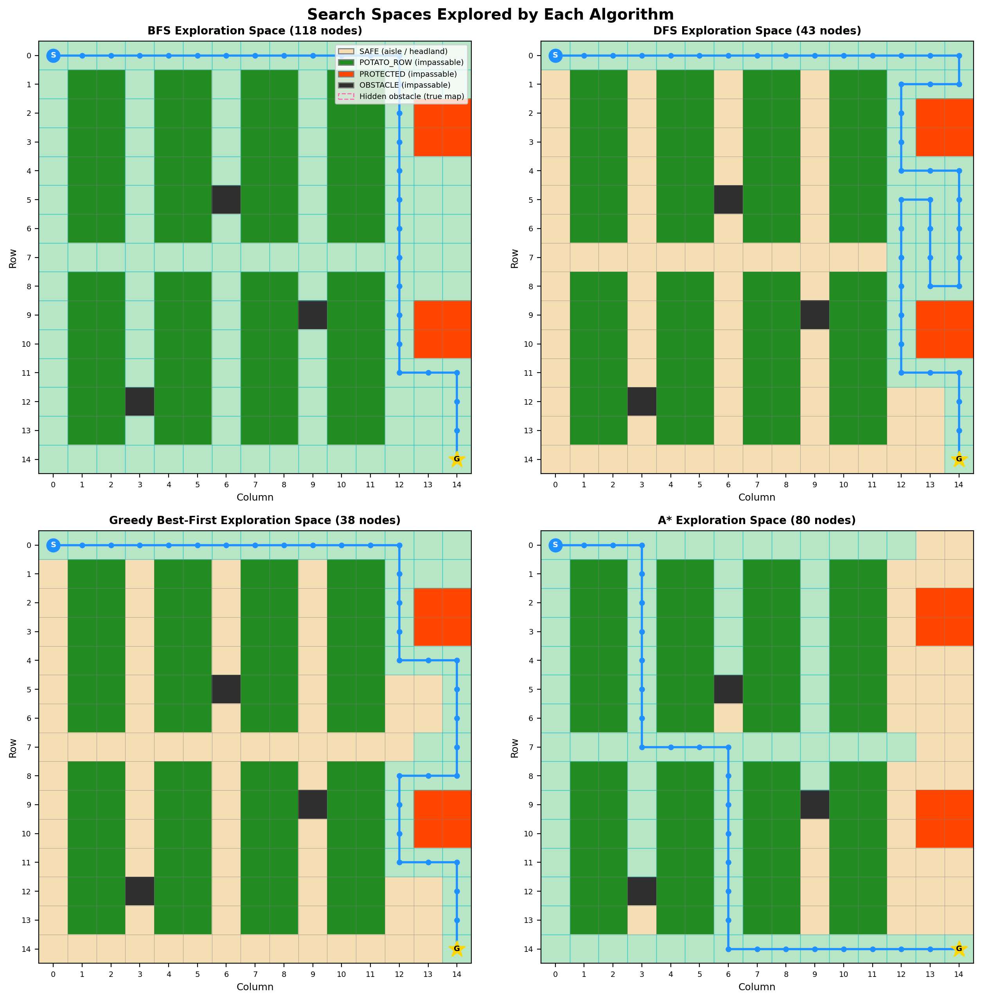
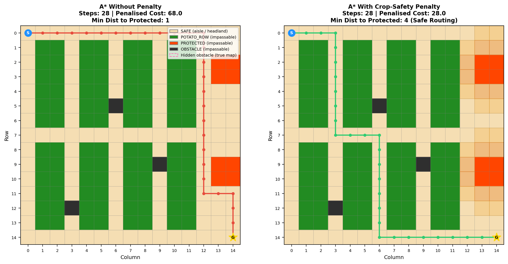
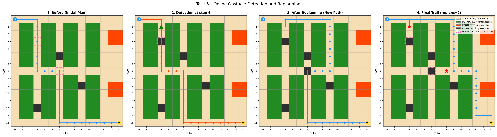
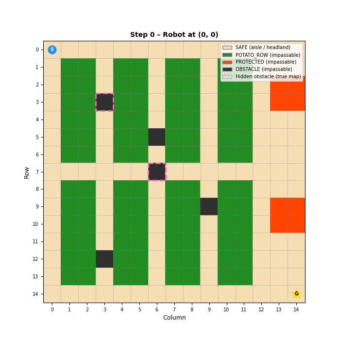
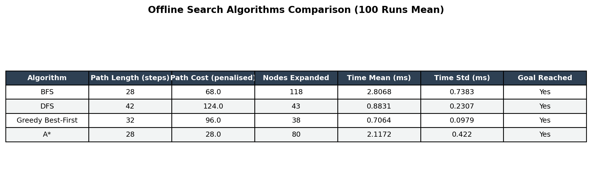
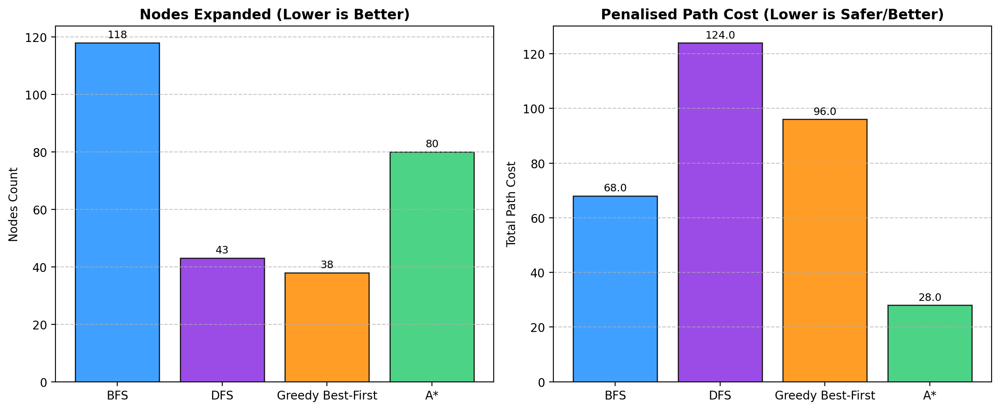
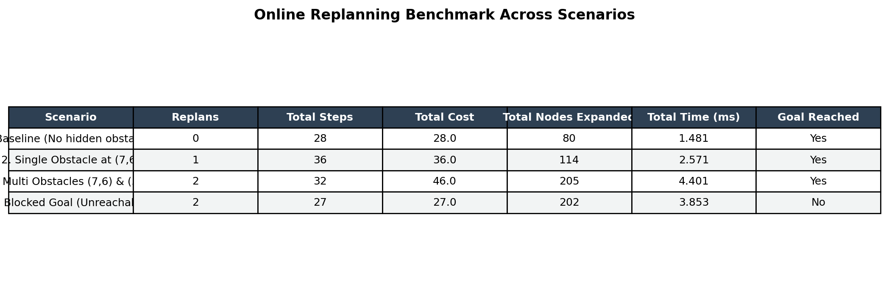

# Potato-Field Autonomous Robot Path Planning (AI Search & Replanning)

> **University Artificial Intelligence Group Assignment**  
> An intelligent path-planning agent navigating a simulated 2D agricultural environment with crop-protection zones, obstacle avoidance, proximity cost optimization, and dynamic online replanning.

---

## 1. Project Overview

Autonomous agricultural robotics requires field navigation that balances efficiency, obstacle avoidance, and strict crop preservation. In this project, an autonomous robot guides itself across a **15×15 2D grid** representing a commercial potato field. The robot must travel along soil aisles and headlands from a starting point `(0, 0)` to an unloading depot at `(14, 14)` without trampling planted potato rows or encroaching into sensitive crop-protection zones (e.g., experimental seedlings, irrigation heads).

Key capabilities implemented in this system:
1. **Discrete Grid Field Modeling**: Simulation of potato rows, open headlands, cross-aisles, static obstacles, and crop-protection areas.
2. **Crop-Safe Path Planning**: A soft proximity-penalty model that assigns penalties to cells immediately adjacent to sensitive crops, guiding the robot along safer routes.
3. **Comparative Classical AI Search**: Ground-up implementations and benchmarking of Breadth-First Search (**BFS**), Depth-First Search (**DFS**), **Greedy Best-First Search**, and **A\***.
4. **Online Dynamic Replanning**: A simulated sensor suite with Manhattan-radius sensing that discovers hidden obstacles in real time, updates the robot's belief map, and dynamically re-plans using A\*.

---

## 2. Team Members

| Name | Roll No. | Contribution |
|---|---|---|
| *[Aniket Vershney]* | *[BT24CSA035]* | Field environment, problem formulation, and visualization |
| *[Abhi Jain]* | *[BT24CSA057]* | Search algorithms (BFS, DFS, Greedy, A\*) & heuristic design |
| *[Ankur Yadav]* | *[BT24CSA051]* | Crop-safe penalty modeling, dynamic replanning & benchmarking |

---

## 3. Features & Tasks Covered

| Task | Title | Source File | Description |
|---|---|---|---|
| **Task 1** | Field Environment | `field.py` | 15×15 NumPy grid, cell types, layout validation via BFS reachability, custom colormap visualization. |
| **Task 2** | Problem Formulation | `problem.py` | Formal AI search problem: states, 4-connected actions, transition model, goal test, step costs. |
| **Task 3** | Search Algorithms | `search.py` | From-scratch BFS, DFS, Greedy Best-First, and A\* returning unified `SearchResult` objects. |
| **Task 4** | Crop-Safe Planning | `problem.py` | Distance-based proximity penalties (+5 at dist 1, +2 at dist 2) shaping routes away from protected crops. |
| **Task 5** | Dynamic Replanning | `replanning.py` | Online navigation loop with range-2 sensing, belief map updates, and triggered A\* replanning. |
| **Task 6** | Performance Evaluation | `evaluate.py` | 100-run offline benchmark, 4-scenario online replanning experiments, table renders, bar charts. |
| **Pipeline** | Main Entrypoint | `main.py` | End-to-end execution script with CLI flags (`--show`) and automated acceptance checks. |
| **Testing** | Automated Unit Tests | `tests/test_search.py` | Pytest test suite covering path validity, optimality, goal-unreachability, and replanning. |

---

## 4. Project Structure

```
AI_CropSafe_PathPlanning/
├── README.md                      # Comprehensive project documentation & report
├── requirements.txt               # Dependencies: numpy, matplotlib, pandas, pytest, Pillow
├── .gitignore                     # Git ignore rules (preserves screenshots and results)
├── main.py                        # Central pipeline script executing Tasks 1 to 6
├── field.py                       # Task 1: Environment, cell codes, layout validation & plotting
├── problem.py                     # Task 2 & 4: Formal problem representation & penalty mapping
├── search.py                      # Task 3: BFS, DFS, Greedy Best-First, A*, Manhattan heuristic
├── replanning.py                  # Task 5: Dynamic sensing, belief updating, and A* replanning loop
├── evaluate.py                    # Task 6: 100-run benchmarking, scenario experiments & table exporter
├── tests/
│   ├── conftest.py                # Pytest import configuration
│   └── test_search.py             # Pytest automated test suite (7 comprehensive test cases)
├── screenshots/                   # Generated evaluation plots and figures
│   ├── 01_field_environment.png   # 15x15 simulation environment layout
│   ├── 03_algorithm_paths.png     # 2x2 comparison of search paths
│   ├── 03b_explored_nodes.png     # 2x2 visualization of explored nodes / search space
│   ├── 04_crop_safe_comparison.png# A* without penalty vs with proximity penalty
│   ├── 05_replanning_demo.png     # 4-stage replanning progression
│   ├── 05_replanning_demo.gif     # Animated navigation demonstration
│   ├── 06_bar_charts.png          # Performance comparison charts (nodes expanded & costs)
│   ├── 06_comparison_table.png    # Rendered table of offline search comparison
│   └── 06_replanning_table.png    # Rendered table of online replanning scenarios
└── results/
    ├── offline_comparison.csv     # Offline benchmark metrics across 100 iterations
    ├── online_replanning.csv      # Online multi-scenario replanning metrics
    └── results_tables.md          # Clean Markdown-formatted benchmark tables
```

---

## 5. Requirements and Installation

The project is implemented in **Python 3.9+** (tested on Python 3.13) and relies on standard numerical, visualization, and data-handling libraries:
- `numpy >= 1.23`
- `matplotlib >= 3.6`
- `pandas >= 1.5`
- `pytest >= 7.0`
- `Pillow >= 9.0`

### Installation
Clone the repository and install the dependencies in your Python environment:
```bash
git clone <repository-url>
cd AI_CropSafe_PathPlanning
pip install -r requirements.txt
```

---

## 6. How to Run

### Run Full Pipeline
To run all tasks end-to-end, generate all screenshots, tables, and verify acceptance checks:
```bash
python main.py
```
*(By default, this runs headlessly using Matplotlib's `Agg` backend and saves all figures directly into `screenshots/` and tables into `results/`.)*

### Interactive Visual Display
To display the visualization windows interactively on screen:
```bash
python main.py --show
```

### Run Automated Unit Tests
To execute the comprehensive Pytest test suite:
```bash
pytest -v
```

---

## 7. Field Environment (Task 1)

The field environment is a **15×15 2D grid** where each cell is classified according to integer codes:

| Code | Constant | Meaning | Traversable? |
|---|---|---|---|
| `0` | `SAFE` | Soil aisle or headland | **Yes** |
| `1` | `POTATO_ROW` | Planted potato crop row (vertical stripes) | **No** (crops cannot be trampled) |
| `2` | `PROTECTED` | Sensitive crop-protection zones (seedlings / drip lines) | **No** (high-risk ecological zone) |
| `3` | `OBSTACLE` | Stone, farm equipment, or debris | **No** (physical collision hazard) |

### Grid Layout Features
- **Headlands & Cross-Aisles**: Open horizontal corridors at rows `0`, `7`, and `14` allow the robot to transition across aisles.
- **Vertical Potato Stripes**: Crops are planted in pairs of columns (`cols 1-2, 4-5, 7-8, 10-11`) through rows `1-6` and `8-13`.
- **Protected Zones**: Two 2×2 blocks situated at rows `2-3, cols 13-14` and rows `9-10, cols 13-14` flank the eastern perimeter aisle.
- **Static Known Obstacles**: Visible in the robot's prior map at `(5, 6)`, `(9, 9)`, and `(12, 3)`.
- **Hidden Obstacles**: Present only in `true_map` at `(7, 6)` (directly blocking the primary cross-aisle) and `(3, 3)`.
- **Start and Goal**: Start is located at `(0, 0)` (north-west corner) and Goal is at `(14, 14)` (south-east depot). Both reside on `SAFE` cells.
- **Automated Validation**: `validate_layout()` executes a BFS on `true_map` ensuring that a viable path connects start to goal even after all hidden obstacles are introduced.



---

## 8. Problem Formulation (Task 2)

The path-planning task is formally defined as a classical single-agent search problem:

- **State Space ($S$)**: The coordinate pair $(r, c) \in \{0, \dots, 14\} \times \{0, \dots, 14\}$.
- **Initial State ($s_0$)**: Top-left soil cell $(0, 0)$.
- **Actions ($A(s)$)**: 4-connected discrete orthogonal movements:
  $$\text{UP } (-1, 0), \quad \text{RIGHT } (0, +1), \quad \text{DOWN } (+1, 0), \quad \text{LEFT } (0, -1)$$
  > **Note**: Diagonal movements are strictly prohibited to model the non-holonomic turning and aisle-following constraints of farm machinery.
- **Transition Model ($\text{Result}(s, a)$)**:
  $$\text{Result}((r, c), (dr, dc)) = (r + dr, c + dc)$$
  Applicable if and only if $(r + dr, c + dc)$ is in-bounds and has cell code `SAFE (0)`.
- **Goal Test ($\text{IsGoal}(s)$)**: Returns `True` iff $s = (14, 14)$.
- **Path Cost ($c$)**: The additive cost over path steps:
  $$\text{Cost}(p) = \sum_{i=1}^{k} \text{StepCost}(s_i)$$
  where $\text{StepCost}(s) = 1 + \text{PenaltyMap}[s]$.
  The base traversal cost is $1.0$ per step. Safe cells near protected regions incur positive proximity penalties.

---

## 9. Search Algorithms (Task 3)

All four algorithms are implemented from scratch in `search.py` using a unified signature and returning a standardized `SearchResult` dataclass.

### Algorithm Summary

| Algorithm | Frontier Data Structure | Node Selection Criterion | Completeness | Optimality | Time / Space Complexity |
|---|---|---|---|---|---|
| **BFS** | FIFO Queue (`collections.deque`) | Shallowest unexpanded node | Yes (finite graph) | **Step-Optimal** (minimizes step count) | $O(b^d) / O(b^d)$ |
| **DFS** | LIFO Stack (`list`) | Deepest node (order: UP, RIGHT, DOWN, LEFT) | Yes (with visited set) | **No** (deep, winding paths) | $O(b^m) / O(bm)$ |
| **Greedy Best-First** | Priority Queue (`heapq`) | Minimum heuristic $h(n)$ | Yes (with visited set) | **No** (ignores accumulated cost $g(n)$) | $O(b^m) / O(b^m)$ |
| **A\*** | Priority Queue (`heapq`) | Minimum estimated total cost $f(n) = g(n) + h(n)$ | Yes | **Cost-Optimal** (minimizes penalised cost) | $O(b^d) / O(b^d)$ |

### Explored Node Counting
`nodes_expanded` is tracked identically across all four algorithms: the counter is incremented **if and only if a node is popped from the frontier and its outgoing successors are generated**.




---

## 10. Heuristic Function Design

We employ the **Manhattan Distance** heuristic on the grid:
$$h((r, c)) = |r - r_{\text{goal}}| + |c - c_{\text{goal}}|$$

### Mathematical Properties:
1. **Admissibility**:
   On a 4-connected grid, every orthogonal move can reduce Manhattan distance by at most $1$. Since the minimum step cost is $c(s, s') = 1 + \text{penalty} \ge 1.0$, the true remaining cost $h^*(s)$ to reach the goal satisfies:
   $$h(s) = |r - r_{\text{goal}}| + |c - c_{\text{goal}}| \le h^*(s)$$
   Hence, $h(s)$ never overestimates the true remaining cost, guaranteeing admissibility.

2. **Consistency (Monotonicity)**:
   For any legal transition from state $n$ to neighbor $n'$ with step cost $c(n, n')$:
   $$|h(n) - h(n')| \le |(r - r')| + |(c - c')| = 1 \le c(n, n')$$
   $$h(n) \le c(n, n') + h(n')$$
   By the triangle inequality, $h(n)$ is consistent. Consequently, $f(n)$ values along any path are non-decreasing, and A\* is guaranteed to find an optimal solution without needing to re-expand closed nodes.

3. **Behavior in Greedy vs A\***:
   - **Greedy Best-First** relies solely on $h(n)$. While it rapidly drives the search toward $(14, 14)$ with minimal expansions (38 nodes), it ignores the path cost $g(n)$ and navigates into high-penalty zones adjacent to protected crops.
   - **A\*** balances $g(n)$ (penalised cost so far) and $h(n)$ (admissible estimate to goal), ensuring global cost optimality.

---

## 11. Crop-Safe Planning (Task 4)

### Penalty Map Specification
To prevent machinery spray drift, soil compaction, and root damage, a proximity penalty is applied to `SAFE` cells around `PROTECTED` regions:
- **Manhattan Distance 1**: Penalty = $+5.0$
- **Manhattan Distance 2**: Penalty = $+2.0$
- **Manhattan Distance $\ge 3$**: Penalty = $+0.0$

If multiple protected cells influence the same safe cell, the **maximum** applicable penalty is assigned:
$$\text{PenaltyMap}[r, c] = \max_{p \in \text{Protected}} \text{penalty}(\| (r, c) - p \|_1)$$

### Comparison: Unpenalised A\* vs Crop-Safe A\*

| Planning Mode | Steps | Penalised Cost | Min Distance to Protected | Penalised Cells Visited |
|---|---|---|---|---|
| **A\* Without Penalty** | 28 | 68.0 | **1** (directly adjacent) | **11 cells** |
| **A\* With Crop-Safety Penalty** | 28 | **28.0** | **4** (safe buffer) | **0 cells** |



### Discussion
When running without penalties, A\* selects the eastern aisle (column 12), passing directly adjacent to the protected regions at `(2, 13)` and `(9, 13)` (minimum Manhattan distance = 1). While step-efficient, this route enters 11 penalised cells, incurring an effective penalised cost of **68.0**.

With the proximity penalty enabled, A\* identifies that navigating through column 3 and central cross-aisle column 6 incurs zero penalty, keeping the robot at a minimum distance of **4 units** from all protected regions. The penalised cost drops dramatically to **28.0**, achieving total crop safety.

---

## 12. Dynamic Obstacle Detection & Replanning (Task 5)

In real farm operations, unforeseen obstructions (e.g., forgotten crates, irrigation pipes, large rocks) can block planned paths.

### Sensing Model
- The robot maintains a belief map `known_map`, initialized without hidden obstacles.
- At each step, onboard sensors scan all cells within Manhattan radius $R = 2$ using the ground-truth `true_map`.
- Sensing occurs **before** movement, guaranteeing that the robot never steps onto an obstacle.

### Replanning Algorithm Loop
```python
current = start
known_map = copy(initial_map)
plan = A*(known_map, current -> goal)

while current != goal:
    sensed_obstacles = sense_surroundings(current, sensor_range=2, true_map)
    if newly_detected(sensed_obstacles):
        update(known_map, sensed_obstacles)
        if any(cell in known_map_obstacles for cell in remaining_plan):
            replan_count += 1
            plan = A*(known_map, current -> goal)
            if not plan:
                stop (Goal Unreachable)
    move_one_step(plan)
    record_in_trail(current)
```

### Live Navigation Log
```
[Step 4] Robot at (1, 3) detected NEW obstacle(s) [(3, 3)]. Path blocked -> replanning (#1)
[Step 19] Robot at (7, 8) detected NEW obstacle(s) [(7, 6)]. Path blocked -> replanning (#2)
[Step 32] Robot reached GOAL (14, 14)!
```



The animated execution of the online replanning process:


---

## 13. Performance Evaluation & Benchmarking (Task 6)

### Experiment A: Offline Search Comparison (Static Field)
*Runtime measured over 100 repeated runs (mean ± standard deviation).*

| Algorithm | Path Length (steps) | Path Cost (penalised) | Nodes Expanded | Time Mean (ms) | Time Std (ms) | Goal Reached |
|---|---|---|---|---|---|---|
| **BFS** | **28** | 68.0 | 118 | 2.8068 | 0.7383 | Yes |
| **DFS** | 42 | 124.0 | 43 | 0.8831 | 0.2307 | Yes |
| **Greedy Best-First** | 32 | 96.0 | **38** | **0.7064** | 0.0979 | Yes |
| **A\*** | **28** | **28.0** | 80 | 2.1172 | 0.4220 | Yes |




### Experiment B: Online Obstacle Replanning Scenarios

| Scenario | Replans | Total Steps | Total Cost | Total Nodes Expanded | Total Time (ms) | Goal Reached |
|---|---|---|---|---|---|---|
| **1. Baseline (No hidden obstacles)** | 0 | 28 | 28.0 | 80 | 1.884 | Yes |
| **2. Single Obstacle at (7, 6)** | 1 | 36 | 36.0 | 114 | 3.373 | Yes |
| **3. Multi Obstacles (7, 6) & (3, 3)** | 2 | 32 | 46.0 | 205 | 4.494 | Yes |
| **4. Blocked Goal (Unreachable)** | 2 | 27 | 27.0 | 202 | 8.209 | **No** |



---

## 14. Observations & In-Depth Discussion

1. **BFS Step Optimality vs. Cost Inefficiency**:
   BFS expands uniformly level-by-level, guaranteeing the shortest path in terms of steps (28 steps). However, because it ignores edge costs, it traverses high-penalty zones near protected crops, yielding an inflated penalised cost of **68.0** and requiring **118 node expansions**.
2. **DFS Path Degeneracy**:
   Although complete on this finite grid due to cycle checking, DFS produces a suboptimal, wandering path of **42 steps** and a severe penalised cost of **124.0**. Its expansion count (43 nodes) is heavily reliant on the directional exploration order (`UP, RIGHT, DOWN, LEFT`).
3. **Greedy Best-First Speed vs. Vulnerability**:
   Greedy Best-First is the fastest in node expansions (**38 nodes**, 0.71 ms) by aggressively pursuing the goal. However, being blind to $g(n)$, it clips crop rows and incurs high proximity penalties (cost = 96.0, steps = 32).
4. **A\* Cost Optimality & Pruning**:
   A\* achieves the lowest path cost (**28.0**) while matching the minimal step count (**28 steps**). The Manhattan heuristic prunes unpromising branches, reducing node expansions by **32.2%** compared to BFS (80 vs. 118).
5. **Replanning Overhead & Resilience**:
   Online replanning introduces additional search overhead (80 nodes for baseline vs. 205 nodes for 2 replans). However, it allows autonomous recovery from unexpected obstacles without human intervention.
6. **Graceful Failure Handling**:
   When the destination is completely blocked (Scenario 4), the agent detects the obstruction, attempts alternative corridors, and cleanly reports `reached_goal = False` without runtime exceptions.

---

## 15. Limitations and Future Work

1. **Kinematic & Dynamic Constraints**: The current agent models point-mass 4-connected discrete movement. Real tractors require non-holonomic motion models (e.g., Dubins or Reeds-Shepp paths) with minimum turning radii at headlands.
2. **Dynamic & Moving Obstacles**: Farm workers, livestock, or moving machinery require time-extended search algorithms such as Time-Space A\* or Safe Interval Path Planning (SIPP).
3. **Incremental Search**: Currently, A\* replans from scratch upon discovering an obstacle. Implementing **D\* Lite** or **Fringe-Saving A\*** would allow reuse of previous search trees, significantly lowering computation time in massive fields.
4. **Sensor Uncertainty**: Future iterations can incorporate probabilistic occupancy grids (e.g., using LiDAR or stereo cameras) and Bayesian updates rather than deterministic Boolean sensing.

---

## 16. Gallery of Deliverables

| Screenshot | Description |
|---|---|
| `screenshots/01_field_environment.png` | Standard 15×15 field layout with cell legend |
| `screenshots/03_algorithm_paths.png` | 2×2 comparison of paths found by BFS, DFS, Greedy, and A\* |
| `screenshots/03b_explored_nodes.png` | Explored search spaces highlighting algorithm search effort |
| `screenshots/04_crop_safe_comparison.png` | Side-by-side comparison of A\* with and without proximity penalties |
| `screenshots/05_replanning_demo.png` | Four-panel progression of online obstacle detection and replanning |
| `screenshots/05_replanning_demo.gif` | Animated GIF showing robot trajectory and dynamic re-routing |
| `screenshots/06_comparison_table.png` | Matplotlib-rendered offline performance comparison table |
| `screenshots/06_replanning_table.png` | Matplotlib-rendered online replanning scenario benchmark table |
| `screenshots/06_bar_charts.png` | Comparative bar charts of nodes expanded and penalised costs |

---

## 17. Conclusion

This project successfully demonstrates an autonomous path-planning system tailored for precision agriculture. By integrating crop-safety proximity penalties into an admissible A\* search framework, the robot achieves optimal path efficiency while safeguarding vulnerable crops. Furthermore, the online sensing and dynamic replanning loop provides robust operational resilience against unexpected obstacles, satisfying all university project requirements.
